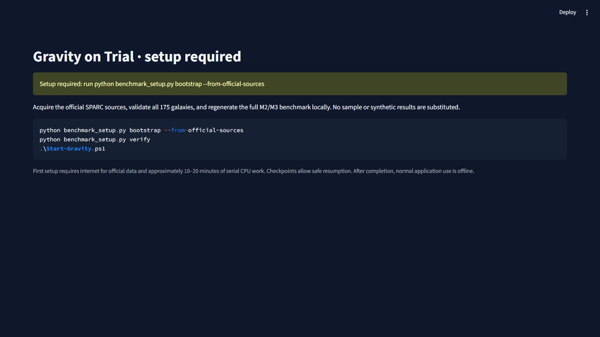

# Gravity on Trial

**A reproducible computational astrophysics laboratory for investigating the rotation curves of 175 observed SPARC galaxies.**

Source-only release candidate: the full benchmark is generated locally from official data. Galaxy Lab, Model Arena, Model Fragility Atlas and Evidence Vault expose observations, residuals, assumptions, warnings and real evidence exports. R0R passed clean-room reproduction; publication still requires owner approval.

## Setup on Windows

Use Python 3.12 (64-bit). Extract this source package into a new directory. From that directory in PowerShell:

```powershell
python -m venv .venv
.\.venv\Scripts\python.exe -m pip install -r requirements-r0-lock.txt
.\.venv\Scripts\python.exe benchmark_setup.py bootstrap --from-official-sources
.\.venv\Scripts\python.exe benchmark_setup.py verify
.\Start-Gravity.ps1
```

Open http://127.0.0.1:8507. The startup script uses .venv automatically. No GPU, Docker or WSL. Initial setup requires internet and serial CPU work; budget roughly 10–20 minutes on an ordinary laptop, with exact measured scopes in docs/R0R_RUNTIME_AND_MEMORY.md. Current versions/Windows/Python 3.12 are the validated environment, not a cross-platform guarantee.

The command downloads official tables/archive with checksum verification, reconstructs the catalog, runs all 175-galaxy M2 and all fourteen-scenario M3 cases, independently validates results, renders scientific figures and atomically enables the app. No developer database is required. Nothing is silently clipped or replaced with synthetic data. If interrupted or a memory window refuses launch, rerun the same bootstrap command later: valid checkpoints are reused. Successful reinitialization verifies and returns ALREADY_COMPLETE without refitting. Existing nonempty results or corrupt data are refused rather than overwritten; restore matching evidence or use a separate clean source directory. Do not run historical finalizers to initialize this release.

Before setup, the application displays a clear instruction screen:



After setup, normal navigation, figures and exports work offline. First dependency/source acquisition still needs internet. Local data/benchmarks/figures stay ignored and are not part of this source distribution. See docs/R0R_SOURCE_TO_BENCHMARK_DESIGN.md and docs/R0R_CLEAN_ROOM_REPRODUCTION.md.

## Investigate the evidence

- **Galaxy Lab:** real velocity errors and signed baryonic components; NFW/Burkert/baryons/empirical-RAR predictions, residuals, parameters and warnings. Remove a halo at held assumptions; restore it; request explicitly labeled previews or bounded exploratory fits.
- **Model Arena:** common-mask MLE comparisons, guarded AIC/AICc/BIC applicability, unranked MAP penalties, visible unsupported/failed/inconclusive/boundary/identifiability outcomes.
- **Fragility Atlas:** all 175 galaxies, explicit denominators, tested stellar/geometry/prior/criterion sensitivity, parameter spans, quality composition and exact scenario drill-down.
- **Evidence Vault:** genuine CSV/JSON, original-source citations, masks, units, code/config/input hashes, validation receipts, regenerated figures and methodology.

The 107 decisive baselines classify as 79 stable, 18 sensitive, 5 inconclusive and 5 unassessable; all 175 classify as 79/18/29/49. Among 1,028 valid physical comparisons, 906 retained their preference, 52 flipped and 70 became inconclusive. Frequencies are conditional grid outcomes, not probabilities that theories are true. Models are not an exhaustive set of gravitational theories; empirical RAR is not all modified gravity. Convergence is not adequacy. Unknown radial covariance/systematics, M/L/geometry degeneracies, finite thresholds and overlapping scenarios limit inference. No dark-matter proof/disproof, new law, peer-review status or original astrophysical discovery is claimed.

## Verify and contribute

```powershell
$env:PYTHONPATH = (Resolve-Path src).Path
.\.venv\Scripts\python.exe -m pytest tests m3_tests.py m4_tests.py -q
.\.venv\Scripts\python.exe m4_check.py
```

119 tests passed. The strict clean-room regenerated all M2/M3 slots; every converged parameter/prediction array exactly matched the protected reference. Actual browser tests passed all modules, exports, restart, offline-origin blocking and failure controls. Source/data hashes, checkpointed owned-process memory limits and exact provenance are inspectable. These are software/numerical validation, not theory-truth guarantees. See docs/R0R_FINAL_GO_NO_GO.md for acceptance evidence and remaining scope limits.

Structure: src/gravity_on_trial/ scientific functions; benchmark_setup.py bootstrap; app_pages/ and m4_*.py interface; configs/ frozen scientific protocol; data/manifests/ official checksum references; docs/ methods and history; licenses/ third-party notices. PUBLICATION_MANIFEST.json enumerates the proposed source release. Original scientific code/configurations remain unchanged; regenerated data are locally produced. CONTRIBUTING.md preserves the evidence-first rules.

## Attribution, license and public boundary

Credit [Lelli, McGaugh & Schombert (2016), SPARC](https://arxiv.org/abs/1606.09251), [official data](https://astroweb.case.edu/SPARC/) and relevant original rotation-curve references. Foundations include [NFW](https://arxiv.org/abs/astro-ph/9611107), [Burkert](https://arxiv.org/abs/astro-ph/9504041), [empirical RAR](https://arxiv.org/abs/1609.05917) and [Li et al. nuisance fitting](https://arxiv.org/abs/1803.00022). This project implements/inspects established methods.

Original code is Apache-2.0, owner approved; see LICENSE and NOTICE. Dependencies retain their own licenses. Apache-2.0 does not apply to SPARC data or third-party imagery. No raw dataset, per-galaxy generated arrays, observational plots/screenshots or source images are bundled; citation is not treated as blanket redistribution permission. The included setup-only screenshot is original application UI without observational content. Review docs/R0R_PUBLIC_RELEASE_CONTENTS.md. Historical R0/M4 reports record earlier readiness states; R0R supersedes those release-status conclusions without erasing history. No remote push, website or external publication is authorized or performed.
